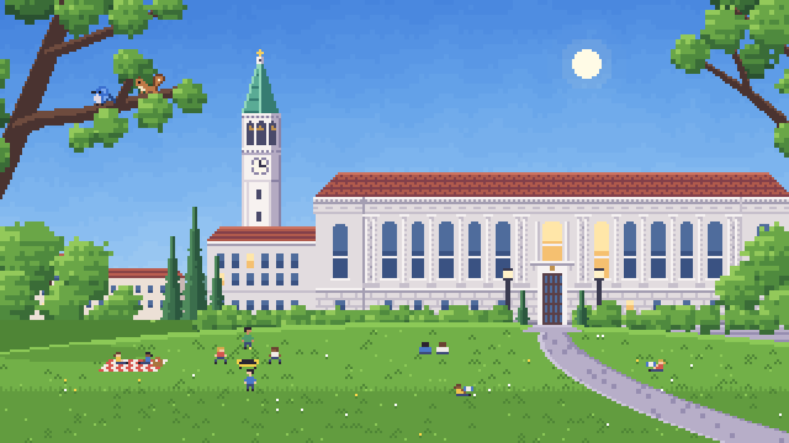
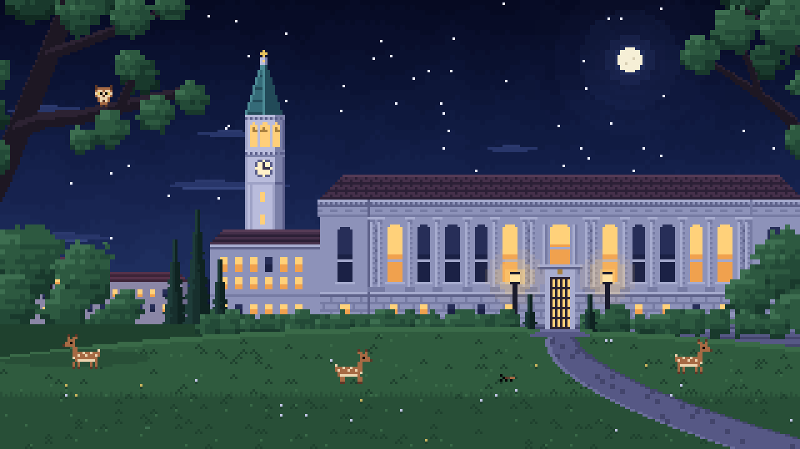
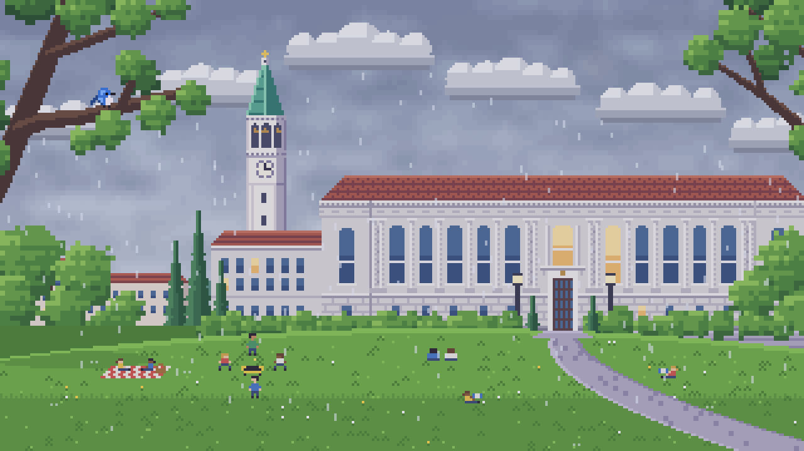

# CalScape

A Berkeley-themed pixel art world with ambient sounds for studying.

Put it on the TV, add rain, a bird or the Campanile bell, and let it run in the
background. Every sound belongs to something you can see in the scene.


## The Glade

The Glade faces Doe Library, with the Campanile behind it on the left. It has
three times of day, each with its own people, light and four ambient elements.

| Day | Sunset |
| --- | --- |
|  |  |
| **Night** | **Rain** |
|  |  |

| Time | Elements |
| --- | --- |
| Day | Rain, Campanile bell, songbird, squirrel |
| Sunset | Rain, Campanile bell, mourning dove, breeze |
| Night | Rain, Campanile bell, owl, crickets |

The third slot is always that time's bird. Rain turns the sky overcast in that
time of day's own cloud colours and hides the sun, moon and stars.

## Running

```sh
npm install
npm run dev      # http://localhost:5173
npm run build    # static build in dist/, no backend needed
```

## Using it

- **Inventory (bottom centre):** the four elements for the current time of
  day. Click a tile to add that element to the Glade; click it again to
  remove it. Tiles for elements in the scene are outlined in blue.
- **Scene objects:** hover a sprite to outline it and show its control bar
  (mute, volume down, level, volume up, remove). Changing the volume plays a
  short sample at the new level. Click to pin the bar; click elsewhere or press
  Escape to close it. On touch, tap the sprite.
- **Keyboard:** Tab to a sprite, press Enter to open its controls.
- **Bottom left:** sun, sunset and moon tiles switch the time of day. Elements
  offered at both times keep playing; the others fade out and come back,
  with their mute and volume, when you switch back.
- **Bottom right:** click the speaker to mute everything, the blocks to set the
  master volume (click, drag or arrow keys), and the corner tile for fullscreen.
- Controls fade out after five seconds of inactivity; move the pointer or press
  a key to bring them back.

Adding an animal plays its call straight away, then it calls every so often.
The Campanile chimes once when added, then tolls the hour on your computer's
clock at the top of every hour: once at 1 o'clock, twice at 2, up to twelve
times at noon and midnight, with strikes 4 seconds apart.

## Sounds

Every sound is kept ambient: quiet defaults, even beds and rare calls.

Rain, breeze, crickets, the songbird and the squirrel are synthesised in the
browser by `src/audio/engine.ts`. The cricket chorus is periodic like a real
field: a few nearby crickets chirp on steady beats over fainter distant ones.

The bell, `src/audio/sounds/campanile.mp3`, is a single strike isolated from a
recording of the Campanile: only the bell's partials are kept, so traffic and
footsteps are removed, and the ring-out is extended from the partials' own
decay. If the file fails to load, a synthesised bell tuned to the Great Bear
Bell's low G plays instead.

The mourning dove, `src/audio/sounds/dove.mp3`, is one perch-coo cut from
"Zenaida macroura - Mourning Dove" (xeno-canto XC128006) by Jonathon Jongsma,
licensed [CC BY-SA 3.0](https://creativecommons.org/licenses/by-sa/3.0/), via
[Wikimedia Commons](https://commons.wikimedia.org/wiki/File:Zenaida_macroura_-_Mourning_Dove_XC128006.ogg).

The great horned owl, `src/audio/sounds/owl.mp3`, is one "hoo, hoo-hoo, hoo"
from "Bubo virginianus - Great Horned Owl" (xeno-canto XC450919) by Michael &
Katie LaTour, licensed [CC BY-SA 4.0](https://creativecommons.org/licenses/by-sa/4.0/), via
[Wikimedia Commons](https://commons.wikimedia.org/wiki/File:Bubo_virginianus_-_Great_Horned_Owl_XC450919.mp3).

Both calls are nearly pure tones, so the background is removed by tracking
each note's pitch and keeping only that pitch and its harmonics; the gaps
between notes are silent. The adapted clips are shared under the same
licenses as their sources. The dove and owl fall back to synthesised calls if
their files fail to load.

## Layout

- `src/scene/` — the 320×180 logical scene: palettes, sprites, people on the
  Glade, the backdrop layers (sky, Doe's north facade, lawn, canopies) and the
  `World` renderer, which also owns silhouette masks for outlines and
  hit-testing. The scene scales to cover the window, cropping at most 20% of
  either axis.
- `src/audio/engine.ts` — Web Audio engine; `sync()` is idempotent so React
  rerenders cannot start duplicate loops. Editing it reloads the page, since
  hot reload would otherwise keep the old engine running.
- `src/elements.ts` — element definitions and each time of day's inventory.
- `src/state.ts` — element presence, mute, volume, time of day (day, sunset or night) and master volume.
- `src/ui/` — inventory, corner controls, anchored element bar and pixel icons.
- `src/audio/sounds/` — audio recordings (the Campanile bell, mourning dove and owl).
- `docs/PRD.md` — product requirements, kept in step with the app.
- `docs/screenshots/` — the images in this README.
