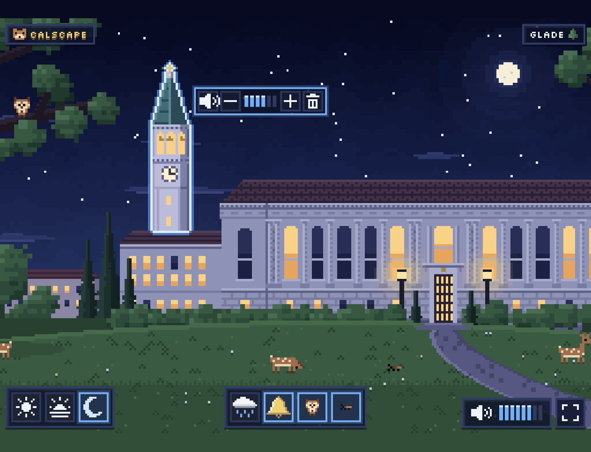
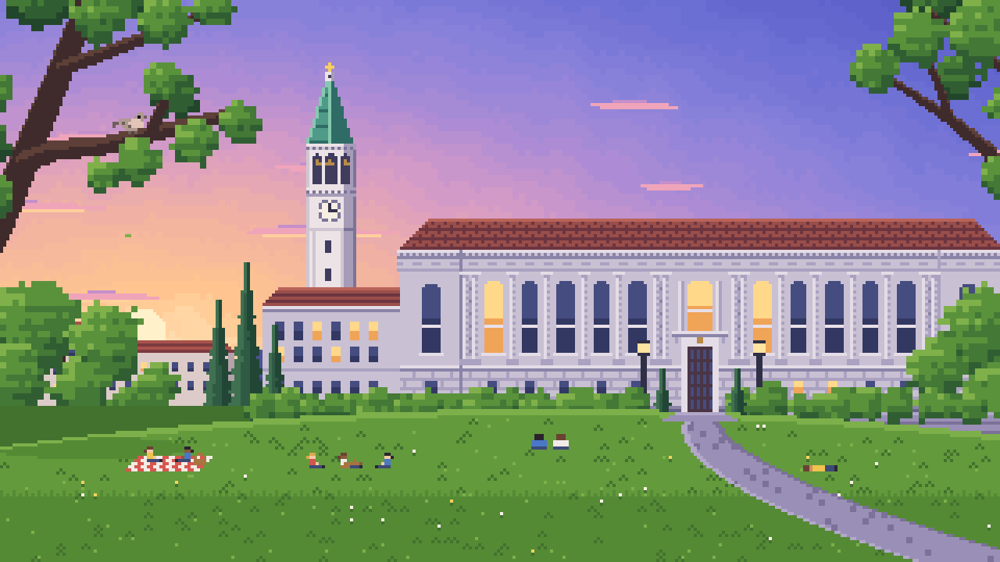
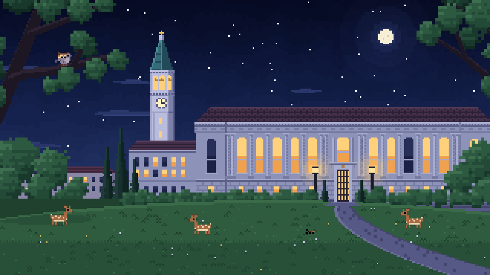
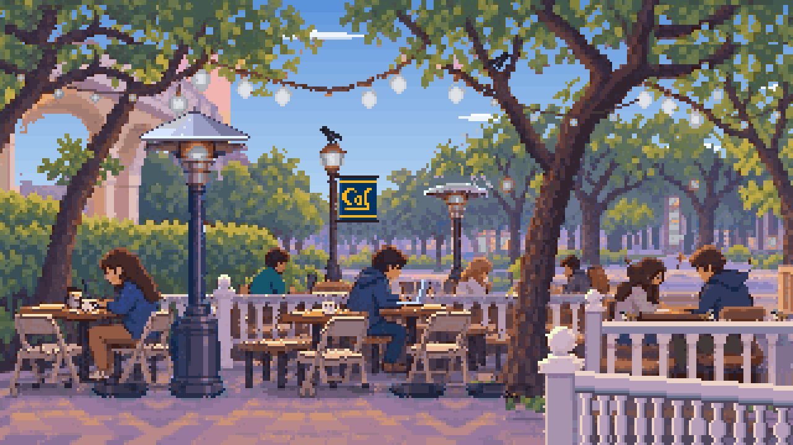
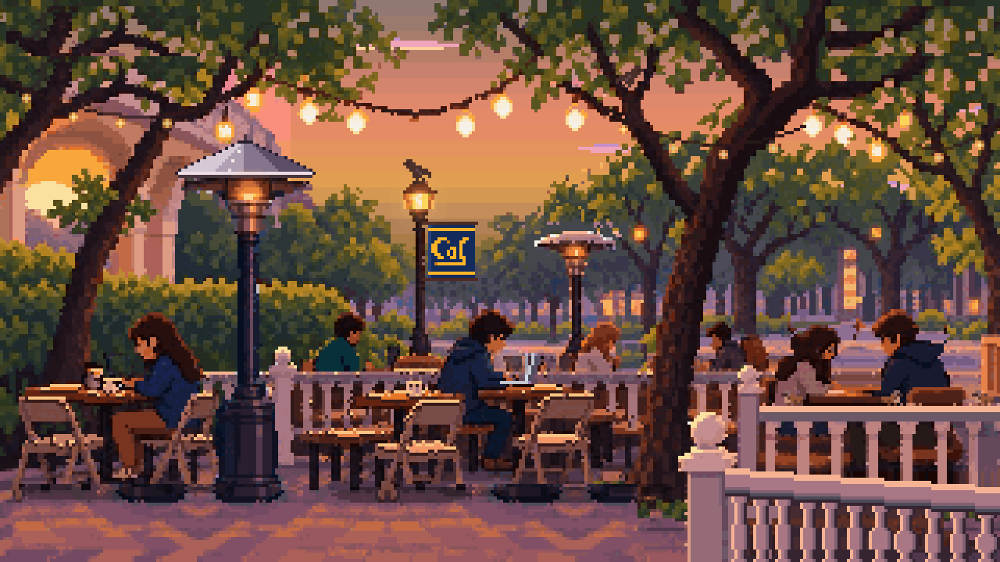
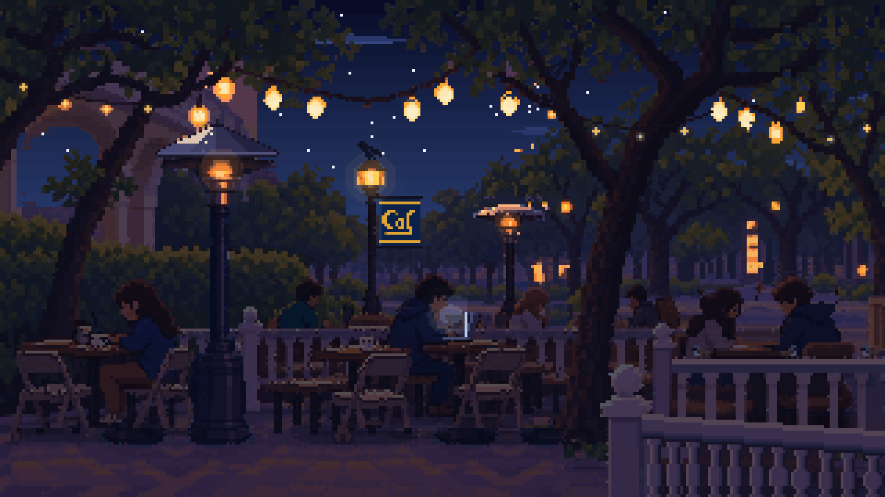
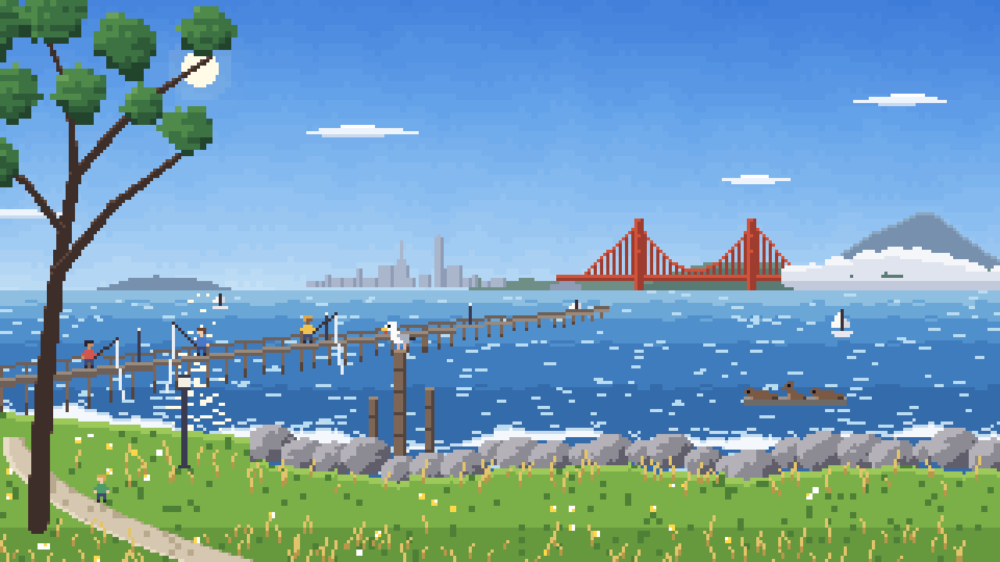
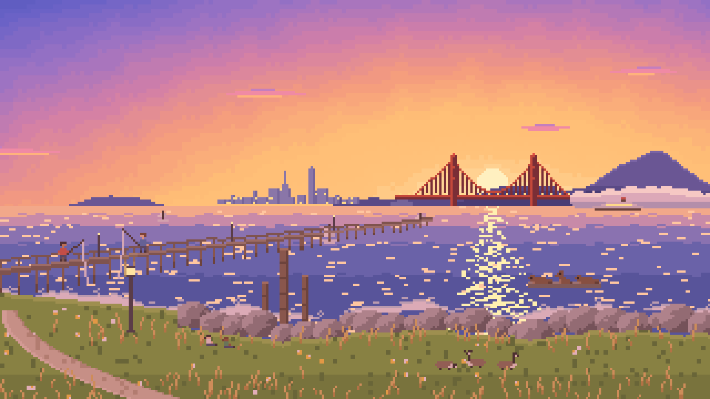
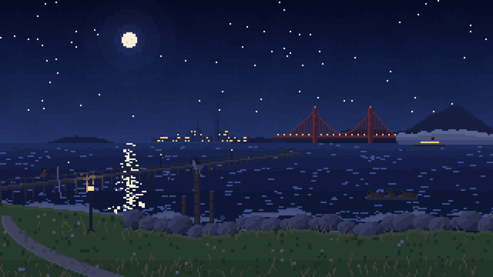

# CalScape

A Berkeley-themed pixel art world with ambient sounds for studying.

Put it on the TV, pick a spot around Berkeley, add rain, a bird or the
Campanile bell, and let it run in the background. Every sound belongs to
something you can see in the scene.

There are three scenes: the Glade facing Doe Library, the patio of Caffè
Strada, and the shore at the Berkeley Marina. The icons in the top-right label
switch between them.



## The Glade

The lawn facing Doe Library, with the Campanile behind it on the left.

| Day | Sunset |
| --- | --- |
|  |  |
| **Night** | **Rain** |
|  |  |

| Time | Elements |
| --- | --- |
| Day | Rain, Campanile bell, songbird, squirrel |
| Sunset | Rain, Campanile bell, mourning dove, breeze |
| Night | Rain, Campanile bell, owl, crickets |

## Caffè Strada

The patio of Caffè Strada at College and Bancroft, under the plum trees and
string lights, with a Cal banner on the street lamp and the campus plaza
beyond.

| Day | Sunset | Night |
| --- | --- | --- |
|  |  |  |

| Time | Elements |
| --- | --- |
| Day | Rain, café chatter, house sparrow, laptop typing |
| Sunset | Rain, café chatter, crow, laptop typing |
| Night | Rain, café chatter, crickets, laptop typing |

## Berkeley Marina

The grassy shore beside the Berkeley Marina pier, looking west across the bay
to San Francisco and the Golden Gate Bridge.

| Day | Sunset | Night |
| --- | --- | --- |
|  |  |  |

| Time | Elements |
| --- | --- |
| Day | Waves, foghorn, western gull, sea lions |
| Sunset | Waves, foghorn, Canada geese, sea lions |
| Night | Waves, foghorn, black-crowned night heron, sea lions |

## Running

```sh
npm install
npm run dev      # http://localhost:5173
npm run build    # static build in dist/, no backend needed
```

## Using it

- **Top right:** three scene icons: a pine for the Glade,
  a coffee cup for Caffè Strada and a sailboat for the Marina. Each scene keeps
  its own elements, mute and volume while you're elsewhere. Switching fades
  out the old scene's sounds; rain and crickets carry on without restarting
  if they're also added in the new scene.
- **Inventory (bottom centre):** the four elements for the current scene and
  time of day. Click a tile to add that element to the scene; click it again
  to remove it. Tiles for elements in the scene are outlined in blue.
- **Scene objects:** hover a sprite to outline it and show its control bar
  (mute, volume down, eight-step level, volume up, remove). Elements start at
  the middle step and go up to twice that. Changing the volume plays a
  short sample at the new level. Click to pin the bar; click elsewhere or press
  Escape to close it. On touch, tap the sprite.
- **Keyboard:** Tab to a sprite, press Enter to open its controls.
- **Bottom left:** sun, sunset and moon tiles switch the time of day. Elements
  offered at both times keep playing; the others fade out and come back,
  with their mute and volume, when you switch back.
- **Bottom right:** click the speaker to mute everything, the blocks to set the
  master volume (click, drag or arrow keys), and the corner tile for fullscreen.
- Controls fade out after five seconds of inactivity; move the pointer or press
  a key to bring them back.

Adding an animal plays its call straight away, then it calls every so often.
The Campanile chimes once when added, then tolls the hour on your computer's
clock at the top of every hour: once at 1 o'clock, twice at 2, up to twelve
times at noon and midnight, with strikes 4 seconds apart.

## Sounds

Every sound is kept ambient: quiet defaults, even beds and rare calls.

Rain, breeze, crickets, the songbirds and the squirrel are synthesised in the
browser by `src/audio/engine.ts`. The cricket chorus is periodic like a real
field: a few nearby crickets chirp on steady beats over fainter distant ones.
One scrub jay sits on the branch, but the songbird sound is a loose,
background chorus of about six birds around the Glade, each with its own song
(a warble, a trill or slurred whistles) and stereo position. Most are
distant, so they're quieter and softer; the perched bird is the nearest and
sings once per chorus.

Every element starts at four of eight bars. Each sound's full gain is tuned
so four bars sits at a comfortable ambient level for it.

The bell, `src/audio/sounds/campanile.mp3`, is a single strike isolated from a
recording of the Campanile: only the bell's partials are kept, so traffic and
footsteps are removed, and the ring-out is extended from the partials' own
decay. If the file fails to load, a synthesised bell tuned to the Great Bear
Bell's low G plays instead.

The mourning dove, `src/audio/sounds/dove.mp3`, is one perch-coo cut from
"Zenaida macroura - Mourning Dove" (xeno-canto XC128006) by Jonathon Jongsma,
licensed [CC BY-SA 3.0](https://creativecommons.org/licenses/by-sa/3.0/), via
[Wikimedia Commons](https://commons.wikimedia.org/wiki/File:Zenaida_macroura_-_Mourning_Dove_XC128006.ogg).

The great horned owl, `src/audio/sounds/owl.mp3`, is one "hoo, hoo-hoo, hoo"
from "Bubo virginianus - Great Horned Owl" (xeno-canto XC450919) by Michael &
Katie LaTour, licensed [CC BY-SA 4.0](https://creativecommons.org/licenses/by-sa/4.0/), via
[Wikimedia Commons](https://commons.wikimedia.org/wiki/File:Bubo_virginianus_-_Great_Horned_Owl_XC450919.mp3).

Both calls are nearly pure tones, so the background is removed by tracking
each note's pitch and keeping only that pitch and its harmonics; the gaps
between notes are silent. The adapted clips are shared under the same
licenses as their sources. The dove and owl fall back to synthesised calls if
their files fail to load.

The Caffè Strada and Marina sounds are recordings (apart from the
synthesised cup clinks over the café chatter), cleaned the same way:
band-limited to the useful range, with steady background noise gated out,
trimmed to single calls, levelled, and faded in and out. Loops have their end
crossfaded into their start so they repeat without a seam. These elements
have no synthesised stand-in and stay silent if their file fails to load.

| File | Source | Author | License |
| --- | --- | --- | --- |
| `chatter.mp3` | [Cafe ambiance](https://commons.wikimedia.org/wiki/File:Cafe_ambiance.ogg) | Marble Toast | [CC0](https://creativecommons.org/publicdomain/zero/1.0/) |
| `typing.mp3` | [Laptop keyboard](https://commons.wikimedia.org/wiki/File:Laptop_keyboard.ogg) | russiandoll | Public domain |
| `sparrow.mp3` | [House Sparrow, xeno-canto XC543237](https://commons.wikimedia.org/wiki/File:Passer_domesticus_-_House_Sparrow_XC543237.mp3) | Benoît Van Hecke | [CC BY-SA 4.0](https://creativecommons.org/licenses/by-sa/4.0/) |
| `crow.mp3` | [American Crow, xeno-canto XC115429](https://commons.wikimedia.org/wiki/File:Corvus_brachyrhynchos_-_American_Crow_XC115429.mp3) | Jonathon Jongsma | [CC BY-SA 3.0](https://creativecommons.org/licenses/by-sa/3.0/) |
| `waves.mp3` | [Nauset Beach](https://commons.wikimedia.org/wiki/File:NausetBeach.ogg) | Groov3 | [CC BY-SA 4.0](https://creativecommons.org/licenses/by-sa/4.0/) |
| `foghorn.mp3` | [Original foghorn at East Brother Island Lighthouse](https://commons.wikimedia.org/wiki/File:Original_foghorn_at_East_Brother_Island_Lighthouse.ogg) | Elwood P. Dowd | [CC0](https://creativecommons.org/publicdomain/zero/1.0/) |
| `gull.mp3` | [Western Gull, Golden Gate National Recreation Area](https://commons.wikimedia.org/wiki/File:Western_Gull_Golden_Gate_National_Recreation_Area.ogg) | National Park Service | Public domain |
| `geese.mp3` | [Geese Honking (distant)](https://commons.wikimedia.org/wiki/File:Geese_Honking_(distant).ogg) | U.S. Fish and Wildlife Service | Public domain |
| `heron.mp3` | [Black-crowned Night Heron, xeno-canto XC481741](https://commons.wikimedia.org/wiki/File:Nycticorax_nycticorax_-_Black-crowned_Night_Heron_XC481741.mp3) | Jens Loose | [CC BY-SA 4.0](https://creativecommons.org/licenses/by-sa/4.0/) |
| `sealions.mp3` | [California Sea Lion at Noyo Harbor](https://commons.wikimedia.org/wiki/File:California_Sea_Lion_at_Noyo_Harbor_-_October_2022_-_Sarah_Stierch.webm) | Sarah Stierch | [CC BY 4.0](https://creativecommons.org/licenses/by/4.0/) |

Clips adapted from CC BY and CC BY-SA sources are shared under the same
licenses as their sources.

## Layout

- `src/scenes.ts` — the scene registry: each scene's elements and their
  control-bar anchors, inventory per time of day, tile art and page colours.
- `src/scene/glade/`, `src/scene/strada/`, `src/scene/marina/` — one folder per
  scene: its palette, sprites, backdrop layers and the `Stage` subclass that
  animates and draws it.
- `src/scene/` — what the scenes share on the 320×180 logical canvas: `Stage`
  (silhouette masks for outlines and hit-testing), palettes and relighting,
  stepped skies, the pixel painter, sprites, foliage and people. The scene
  scales to cover the window, cropping at most 20% of either axis.
- `src/audio/engine.ts` — Web Audio engine; `sync()` is idempotent so React
  rerenders cannot start duplicate loops. Editing it reloads the page, since
  hot reload would otherwise keep the old engine running.
- `src/elements.ts` — element ids, per-element state and volume steps.
- `src/state.ts` — the current scene, each scene's element presence, mute and
  volume, the time of day (day, sunset or night) and master volume.
- `src/ui/` — inventory, corner controls, anchored element bar and pixel icons.
- `src/audio/sounds/` — audio recordings, credited above.
- `public/` — the favicon (the CalScape bear) as SVG and PNG, plus the home-screen icon.
- `docs/PRD.md` — product requirements, kept in step with the app.
- `docs/screenshots/` — the images in this README.
